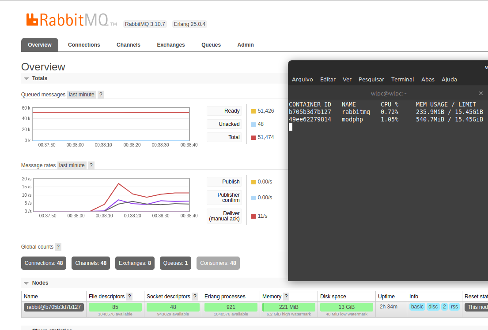

# RabbitRun - Mecanismo de fila

Qualidade de código:

[](https://scrutinizer-ci.com/g/WillRy/rabbitrun/?branch=main)

Biblioteca para criar filas com RabbitMQ de forma rápida e simples: publicar tarefas e consumi-las
com workers, com reconexão automática, confirmação de publicação e encerramento seguro.

Opcionalmente, a fila pode ser espelhada em um banco de dados (veja "Exemplo com banco de dados"),
o que permite pesquisar e excluir/ignorar itens da fila, algo que o RabbitMQ sozinho não oferece.

**Workers**: É possível ter vários workers consumindo a fila ao mesmo tempo, pois o RabbitMQ trata a distribuição de
tarefa entre eles.

## Graceful stop - parar somente após terminar task

Ao receber **SIGTERM** ou **SIGINT** (ex: `docker stop`, Ctrl+C), o worker:

- se estiver ocioso, encerra em até 1 segundo;
- se estiver processando uma task, termina a task atual antes de encerrar.

Em ambos os casos as conexões são fechadas e o `consume()` retorna, permitindo executar código após ele.
Scripts que apenas publicam encerram imediatamente.

## Requisitos

- PHP >= 8.0
- Extensão **pcntl** para consumir filas (não é necessária para apenas publicar)
- RabbitMQ >= 3.8 (Filas do tipo Quorum são recomendadas, veja "Limite de tentativas")

## Desempenho

**Consumo de hardware baixo com 50k de mensagens e 40 workers**




## Como publicar itens na fila

```php
<?php

require_once __DIR__ . '/../../vendor/autoload.php';


$worker = new \WillRy\RabbitRun\Queue\Queue(
    "rabbitmq",
    "5672",
    "admin",
    "admin",
    "/"
);


for ($i = 0; $i <= 1000; $i++) {

    $payload = [
        "id" => $i,
        "id_email" => $i,
        "conteudo" => "blablabla"
    ];

    $worker->publish("queue_teste", $payload);
}


```

## Como consumir itens da fila?

- Defina os callbacks e inicie o consumo com `consume()`

```php
<?php

use PhpAmqpLib\Message\AMQPMessage;

require_once __DIR__ . '/../../vendor/autoload.php';

$worker = new \WillRy\RabbitRun\Queue\Queue(
    "rabbitmq",
    "5672",
    "admin",
    "admin",
    "/"
);


/**
 * Executa quando o worker pega uma tarefa
 *
 * Retorna verdadeiro para o worker executar
 * Retorna false para o worker ficar devolvendo os itens para a fila
 *
 * Utilidade: Dizer se o worker está ativo, com base em algum registro de banco de dados, monitor de serviços
 * e etc
 */
$worker->onCheckStatus(function () {

});

/**
 * Executa ao pegar um item na fila
 * Se retornar false, o item é descartado
 *
 * Se não retornar nada ou verdadeiro, o item é processado no método onExecuting
 */
$worker->onReceive(function ($dados) {
    echo ' [x] [  receive  ] ', json_encode($dados), "\n";
});

/**
 * Método que processa o item da fila
 *
 * Se o callback terminar sem erro, a mensagem recebe ack automaticamente
 * Fazer um $message->ack para marcar como "sucesso" explicitamente
 * Fazer um $message->nack() para descartar
 * Fazer um $message->nack(true) para repor na fila
 *
 * Se alguma exception não for tratada, o item será recolocado
 * na fila
 */
$worker->onExecuting(function (AMQPMessage $message, $dados) {

    echo ' [x] [ executing ] ', json_encode($dados), "\n";

    sleep(1);

//    $number = rand(0, 10) % 2 === 0;
//    if ($number) throw new \Exception("Error");

    $message->ack();

    echo ' [x] [ success ] ', json_encode($dados), "\n";
});

/**
 * Método que executa automaticamente caso aconteça uma exception não tratada
 * durante o processamento
 */
$worker->onError(function (\Throwable $e, $dados) {
    echo ' [x] [   error   ] ', json_encode($dados), "\n";
});


$worker->consume("queue_teste");


```

## Destino da mensagem

- Se o **onExecuting** terminar sem erro e sem responder a mensagem, ela recebe **ack** automaticamente.
- Se o **onExecuting** lançar uma exception não tratada, a mensagem volta para a fila.
- Para decidir o destino explicitamente:

- nack(): marca como erro
- nack(true): marca como erro e coloca novamete na fila
- ack(): marca a tarefa como concluida

## Conexões

Cada instância de `Queue` abre a **sua própria conexão** com o RabbitMQ, então é possível usar
brokers ou vhosts diferentes no mesmo processo. Para publicar de dentro de um consumer, crie o publisher
**uma única vez, fora do callback** (criar dentro do `onExecuting` abriria uma conexão por mensagem):

```php
$worker = new \WillRy\RabbitRun\Queue\Queue("rabbitmq", "5672", "admin", "admin", "/");
$publisher = new \WillRy\RabbitRun\Queue\Queue("rabbitmq", "5672", "admin", "admin", "/");

$worker->onExecuting(function (AMQPMessage $message, $dados) use ($publisher) {
    $publisher->publish("proxima_fila", $dados['payload']);
});
```

## Heartbeat e tarefas longas

A conexão usa **heartbeat de 60 segundos** por padrão, para detectar conexões que morreram em silêncio
(firewall, NAT, load balancer ou queda do servidor) e reconectar automaticamente.

> ⚠️ Durante a execução do `onExecuting` nenhum heartbeat é enviado. Se uma tarefa demorar mais que o
> heartbeat, o RabbitMQ fecha a conexão, o `ack` falha e a mensagem é entregue novamente, repetindo o problema.
> Para tarefas longas, informe um heartbeat maior que a tarefa mais demorada, ou `0` para desativar:

```php
$worker = new \WillRy\RabbitRun\Queue\Queue(
    "rabbitmq", "5672", "admin", "admin", "/",
    heartbeat: 600 // tarefas de até ~10 minutos
);
```

## Limite de tentativas

Por padrão a fila é do tipo **classic** e uma mensagem que sempre falha volta para a fila indefinidamente.

Para limitar as tentativas, use uma fila **quorum** com `deliveryLimit`: após esse número de devoluções
o RabbitMQ descarta a mensagem ou envia para a dead letter exchange (que deve existir previamente).

```php
$worker->configQueue(
    type: 'quorum',
    deliveryLimit: 5,
    deadLetterExchange: 'falhas_exchange' // opcional
);
```

- Publisher e consumer devem chamar o `configQueue` com os **mesmos** valores, pois o RabbitMQ
  não permite redeclarar a fila com argumentos diferentes (`PRECONDITION_FAILED`).
- Uma fila classic existente não pode ser convertida em quorum: é preciso apagá-la ou migrá-la.

O `onError` é chamado **antes** de a mensagem voltar para a fila e recebe a mensagem como 3º argumento,
permitindo controlar as tentativas pelo seu banco de dados e descartar a mensagem:

```php
$worker->onError(function (\Throwable $e, $dados, AMQPMessage $message) {
    if (tentativasEsgotadas($dados)) {
        $message->nack(); // descarta em vez de devolver para a fila
    }
});
```

## Demonstração

Dentro desse repositório tem a pasta **demo**, nela tem 2 exemplos:

- queue: consumer e publisher simples
- queue_db: consumer e publisher que mantém espelho/monitoramento da fila no banco de dados

- **publisher.php**: Arquivo que publica itens na fila
- **consumer.php**: Arquivo que consome itens na fila, podendo ter várias instâncias


## Exemplo com banco de dados

Na pasta **demo/queue_db** tem um exemplo que utiliza o RabbitMQ junto
do banco de dados, com o objetivo de:

- Espelhar a fila no banco de dados (permite excluir um item na fila e ver a situação de cada uma)
- Monitorar o que os workers estão fazendo
- Poder pausar temporariamente a execução dos workers via banco

Ao usar o PDO como driver de espelhamento de fila, deve ser criado as tabelas.

```sql
drop table if exists jobs;

create table jobs
(
    id              bigint auto_increment primary key,
    queue           varchar(255) not NULL COMMENT 'queue name',
    payload         text         not NULL COMMENT 'json content, filter with JSON_EXTRACT',
    retries         int          not null default 0,
    max_retries     int          not null default 10,
    requeue_error   boolean               default true,
    last_error      text COMMENT 'last error description',
    status_desc     text COMMENT 'cancel/other status reason',
    id_owner        bigint COMMENT 'ID to determine the owner (user) of the item in the queue',
    id_object       bigint COMMENT 'ID to determine which object the queue item came from (ex: user, product and etc)r',
    auto_delete_end boolean               default false,
    status          enum('waiting','processing','canceled','error','success') default 'waiting',
    start_at        datetime,
    end_at          datetime,
    INDEX           idx_id_object (id_object),
    INDEX           idx_queue (queue),
    INDEX           idx_id_owner (id_owner)
);

drop table if exists rabbit_monitor;

create table rabbit_monitor
(
    id         bigint primary key auto_increment,
    name       varchar(255) not null,
    status     int          not null default 0,
    jobID      varchar(255) null,
    groupName  varchar(255) not null,
    modifiedAt datetime null
);

```


